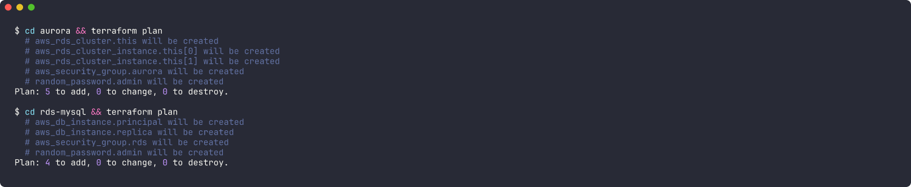
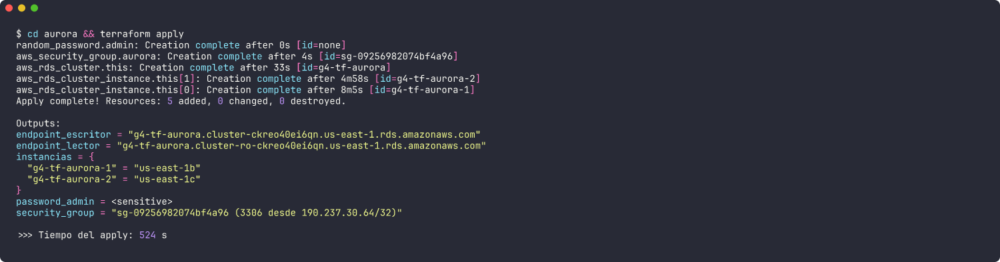
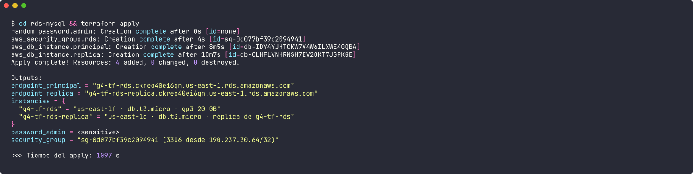
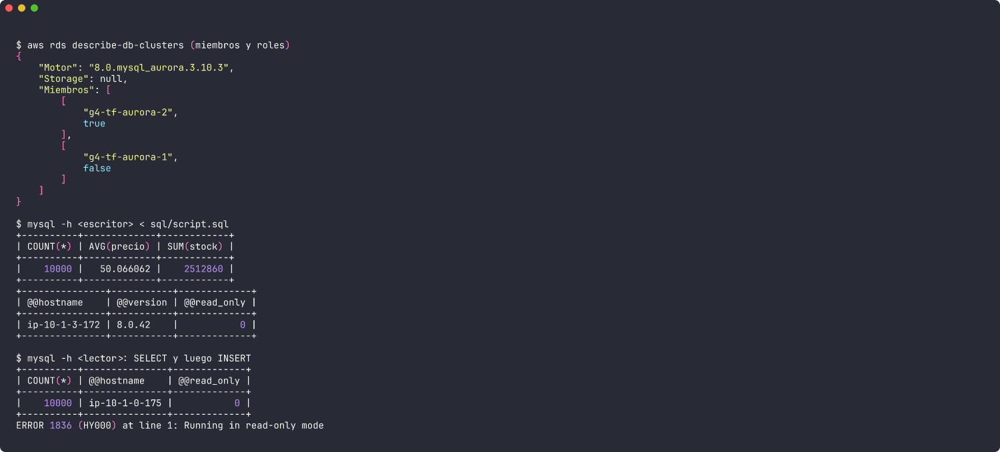
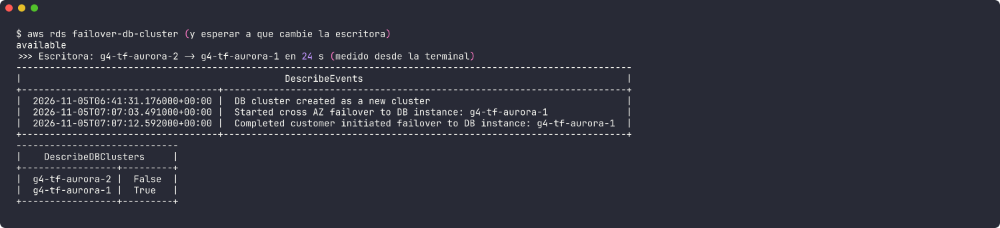
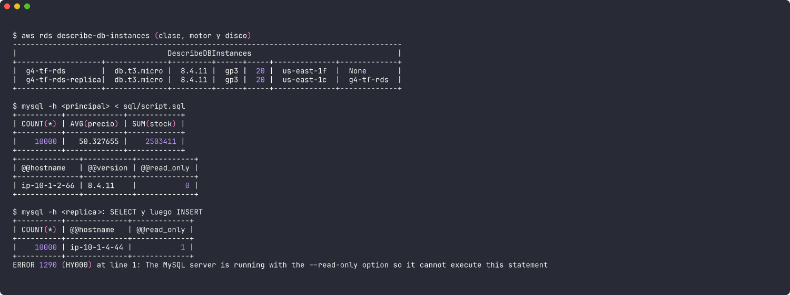
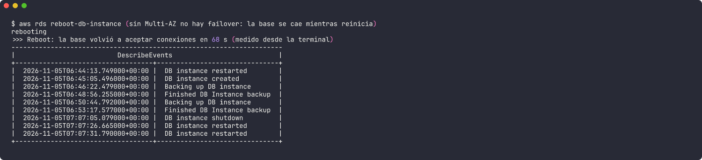
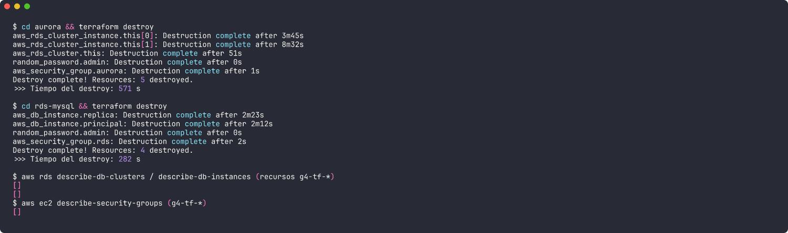

# Grupo 4 · Amazon Aurora vs Amazon RDS for MySQL

**Infraestructura como Código – UPAO 2026**
*Base de datos optimizada para la nube frente a MySQL administrado*

Este repositorio despliega con **Terraform** los dos servicios que compara el grupo, cada uno con su
servicio complementario (la réplica de lectura). Los dos usan la misma cuenta y región y cargan el mismo
script SQL, para que la comparación sea justa.

| Stack | Qué crea | Recursos |
|---|---|---|
| [`aurora/`](aurora) | Security group (3306 solo desde mi IP) + clúster **Aurora MySQL** cifrado + **2 instancias db.t3.medium** en zonas distintas (escritora y réplica lectora) | 5 |
| [`rds-mysql/`](rds-mysql) | Security group (3306 solo desde mi IP) + instancia **RDS for MySQL db.t3.micro** con **gp3 de 20 GB** cifrado + **réplica de lectura** | 4 |

La diferencia se ve en el código: en `aurora/main.tf` **no hay disco**, porque el clúster usa un volumen
compartido que crece solo. En `rds-mysql/main.tf` hay que elegir tipo y tamaño de disco
(`storage_type = "gp3"`, `allocated_storage = 20`), y la réplica es otra instancia con su propia copia de los datos.

```
.
├── aurora/          # Terraform: clúster Aurora MySQL + 2 instancias
├── rds-mysql/       # Terraform: RDS for MySQL + réplica de lectura
├── sql/script.sql   # 10 000 productos de una farmacia (mismo script para las dos demos)
├── scripts/         # demo-aurora.sh y demo-rds.sh: uso del servicio y mediciones
└── docs/evidencias/ # capturas de la ejecución real
```

## Requisitos

- Terraform ≥ 1.6, AWS CLI v2 con credenciales configuradas (`aws configure`, región `us-east-1`).
- Cliente MySQL (`brew install mysql-client` en Mac).
- La contraseña de `admin` la genera Terraform (`random_password`) y no se guarda en el repo. El estado
  (`*.tfstate`) está en `.gitignore`.

## Cómo usarlo

```bash
# 1) Desplegar (se pueden correr los dos a la vez)
cd aurora    && terraform init && terraform apply
cd rds-mysql && terraform init && terraform apply

# 2) Usar cada servicio y medir (desde la raíz del repo)
./scripts/demo-aurora.sh   # script en la escritora, lectura e INSERT rechazado en la réplica, failover
./scripts/demo-rds.sh      # script en la principal, lectura e INSERT rechazado en la réplica, reboot

# 3) Borrar todo para no pagar de más
cd aurora    && terraform destroy
cd rds-mysql && terraform destroy
```

## Resultados medidos

Ejecución real del 5 de noviembre de 2026 en `us-east-1` (cuenta del grupo), con Terraform 1.17 y AWS provider 6.x.

| Medición | Aurora MySQL | RDS for MySQL |
|---|---|---|
| `terraform apply` (todo el stack) | 8 min 44 s · 5 recursos | 18 min 17 s · 4 recursos (la réplica se crea después de la principal) |
| Motor | Aurora MySQL 3.10.3 (compatible con MySQL 8.0.42) | MySQL 8.4.11 |
| Script en la principal | 10 000 filas | 10 000 filas |
| Escritura en la réplica | `ERROR 1836 … read-only mode` | `ERROR 1290 … --read-only option` |
| Recuperación | **Failover** a la réplica: **9 s** según eventos de AWS (07:07:03 → 07:07:12 UTC), 24 s medidos desde la terminal | **Reboot** sin Multi-AZ: **22 s sin servicio** según eventos (07:07:05 → 07:07:26 UTC), 68 s hasta que la terminal volvió a conectar |
| `terraform destroy` | 9 min 31 s · 5 recursos | 4 min 42 s · 4 recursos |
| Costo por hora de la demo (bajo demanda) | ≈ US$ 0,164 (2 × db.t3.medium) | ≈ US$ 0,034 (2 × db.t3.micro) |

## Evidencias

Salida real de la terminal, guardada como imagen (`docs/evidencias/`):

| | |
|---|---|
| 01 · Plan de los dos stacks |  |
| 02 · Apply de Aurora y outputs |  |
| 03 · Apply de RDS for MySQL y outputs |  |
| 04 · Aurora: miembros, script en la escritora y prueba en la lectora |  |
| 05 · Aurora: failover y eventos |  |
| 06 · RDS: instancias, script en la principal y prueba en la réplica |  |
| 07 · RDS: reboot y eventos |  |
| 08 · Destroy de los dos stacks y verificación (sin recursos) |  |

## Autor

Willian Polo ([@gottizz](https://github.com/gottizz)), Grupo 4.
